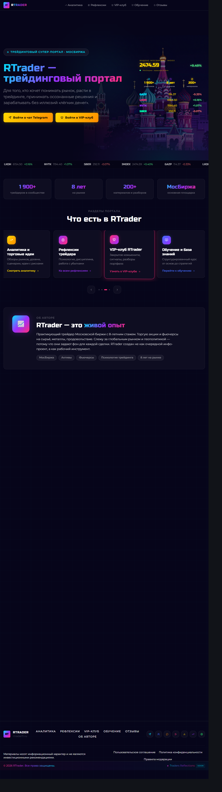
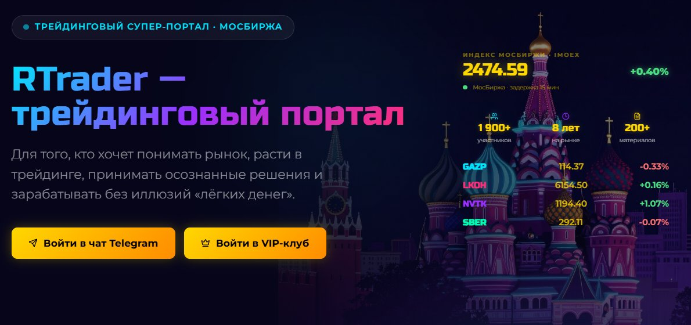

# RTrader — трейдинговый портал МосБиржи

> Закрытое сообщество трейдеров: аналитика, чаты, VIP-клуб, обучение и отзывы — в одном месте.

[Открыть портал](https://rtrader11.traders-reflections.ru) · [Портфолио](https://www.traders-reflections.ru)

## О проекте

RTrader — портал для трейдеров, которые хотят понимать рынок без иллюзий «лёгких денег». Вокруг одного продукта собраны аналитика, обсуждения, обучение и закрытый клуб.

Проект живёт **8 лет**, в нём **1 900+ участников** и **200+ материалов**: разборы, рефлексии, записи и обучающие блоки.

## Что есть на портале

- **Аналитика** — обзоры рынка, уровни, сценарии и идеи с рисками.
- **Чаты** — обсуждение позиций и инструментов МосБиржи.
- **Рефлексии трейдера** — психология, дисциплина, работа с убытками.
- **Конкурсы** — соревновательный формат для участников.
- **VIP-клуб** — закрытые созвоны, сигналы, разборы портфеля.
- **Обучение и база знаний** — структурированный курс.
- **Отзывы** — обратная связь участников.

## Технологии

`React` · `TypeScript` · `Python` · `PostgreSQL` · `nginx` · адаптивная вёрстка

## Результат

| Показатель | Значение |
|---|---:|
| Участников | 1 900+ |
| Лет на рынке | 8 |
| Материалов | 200+ |
| Основная площадка | МосБиржа |

## Скриншоты

## Ссылки

- [Портал RTrader](https://rtrader11.traders-reflections.ru)
- [Портфолио](https://www.traders-reflections.ru)

## Статус

Демонстрационный репозиторий. Исходный код, админ-доступы, конфигурация сервера и данные участников не публикуются.

## Лицензия

Все права защищены. Материалы опубликованы для демонстрации в портфолио.

## Контакты

Telegram: [@Rhodes_4ever](https://t.me/Rhodes_4ever) · Почта: [demetra68@gmail.com](mailto:demetra68@gmail.com)
